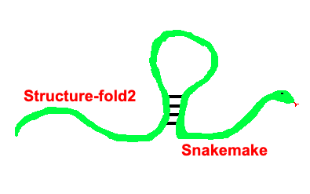
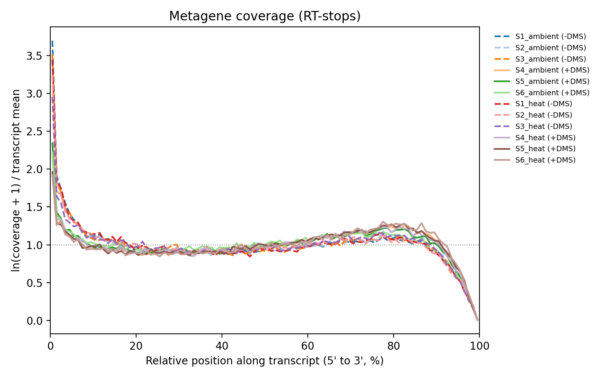

A generalized Snakemake workflow around [StructureFold2](https://github.com/StructureFold2/StructureFold2)
to obtain reactivities from a Structure-seq experiment. Given
raw/trimmed single-end reads and a transcriptome (or a genome + annotation to
build one), it aligns with Bowtie2, counts RT-stops per replicate, and
calculates per-transcript, per-position reactivity. 


## Documentation

# How to run structure-fold2-snakemake

## 1. Install

You need conda (or mamba) and Snakemake 8 or later. The repository's environment has both
Snakemake and the plugin for submitting jobs to a cluster:

```
conda env create -f environment.yml
conda activate structure-fold2-snakemake
```

Snakemake installs every other tool (Bowtie2, cutadapt, samtools, Python packages …) into
per-rule conda environments on the first run. Those are listed in `workflow/envs/`. That first
run needs internet access and a few GB of disk; use `--conda-prefix` to keep the environments
somewhere shared and reuse them between projects.

## 2. Prepare the inputs

### Reads and samplesheet
A tab-separated file with one row per (sample, sequencing run). The minimum is three columns:

```
sample	condition	r1
S1	minus	reads/S1.fastq.gz
S2	plus	reads/S2.fastq.gz
```

`condition` is `plus` (+DMS) or `minus` (−DMS). Add `ID` to group +DMS and −DMS samples into
replicates, `run` for samples sequenced more than once, `temperature` for heat correction, and
`genotype` for genotype mode. See [docs/samplesheet.md](docs/samplesheet.md) and
`config/samplesheet_example.tsv`.

### Reference
Choose one with `transcript_source`:

- `file`: a transcriptome FASTA (`transcriptome`). The first word of each header is the
  transcript ID used in every output.
- `gffread`: a genome FASTA (`genome`) plus annotation (`gff`, GFF3 or GTF). The transcriptome is
  built from them. Two filters, each usable alone or together:
  - `cds_only` (default `true`): keep only transcripts with a CDS.
  - `keep_longest_isoform` (default `false`): keep one isoform per gene, chosen by AGAT (the
    longest CDS; the longest transcript for genes without one).

  With both on, each protein-coding gene keeps its longest coding isoform.

Optional additions to the reference:

| Key | Purpose |
|---|---|
| `positive_control_fasta` + `positive_control_name` | A spike-in of known structure, e.g. `resources/p4p6/p4p6.fa` with name `p4p6`. The name `p4p6` turns on the P4-P6 structure plots and ROC. |
| `ncrna_fasta`, or `ncrna_gff`/`ncrna_gtf` (+ `ncrna_genome`, default `genome`) | rRNA/tRNA/other ncRNA sequences, so those reads align to the right place and not to similar mRNA sequence. Strongly recommended if the transcriptome is coding-only. From an annotation, gffread extracts only the transcripts without a CDS (`ncrna_noncoding_only: false` keeps all), so a full annotation works. |
| `lncrna_fasta`, or `lncrna_gff`/`lncrna_gtf` (+ `lncrna_genome`) | lncRNA sequences, same options as the ncRNA set; their reads are their own `lncRNA` type in the read-composition QC. IDs already in the transcriptome or ncRNA set aren't added twice. |
| `rrna_fasta`, or `rrna_gff`/`rrna_gtf` (+ `rrna_genome`) | rRNA sequences, same options; their reads count as `rRNA`. Not needed when the ncRNA annotation marks its rRNAs (Ensembl `transcript_biotype "rRNA"`, RAP-DB feature type `rRNA`): those are labelled rRNA automatically. |
| `read_composition_priority` | Order used for the read-composition pie (`qc/read_composition_pie.png`, mRNA / rRNA / lncRNA / other / unmapped; `qc/read_composition_pie_mapped.png` for mapped reads only): a read hitting several types goes to the first listed. Default `[rRNA, mRNA, lncRNA]`. |

Some features also read an annotation. Its transcript IDs must match the transcriptome headers
(for 3′ bias correction and the genome check, an Ensembl-style `transcript:` prefix in GFF3 is
also accepted):

| Feature | Needs |
|---|---|
| CDS/UTR labels per position (`transcript_position_annotations.csv`) | `genome` + `annotation_gtf` |
| 3′ bias correction | A GTF/GFF3 with `protein_coding` biotypes (`3_prime_bias_annotation`, default `annotation_gtf` then `gff`) |
| Genome check | `genome`; a full annotation with ncRNA genes (`genome_check_annotation`) gives more informative categories |
| mRNA/ncRNA split in the read-composition QC | Ensembl-style `transcript_biotype:` tags in the transcriptome headers (Ensembl cDNA/ncRNA FASTA have them). Without them every transcript counts as mRNA. |

### Config
Copy `config/config.yaml` and set at least `samplesheet`, `output_dir`, `tmp_dir`,
`transcript_source` and the reference keys. Every other key is optional, with its default shown
in the file. [docs/choosing_options.md](docs/choosing_options.md) explains when to change them. The
main choices:

| Key | Decides |
|---|---|
| `pool_replicates` | Reactivity per replicate (`none`, default) or from pooled libraries (`minus`, `plus`, `both` …) |
| `trimmer`, `max_mismatch` | Trimming tool; mismatches allowed per alignment (default 3) |
| `3_prime_bias_correction` | [3′ bias correction](docs/3_prime_end_bias.md) of +DMS stops |
| `reactivity_normalization` | Scale +DMS and −DMS to their mean over all positions (`all`, StructureFold2, default) or over the G/U positions (`gu`) before the −DMS subtraction ([methods.md §8](docs/methods.md#gu-normalization-reactivity_normalization-gu)) |
| `depth_matching` | [Depth-matched](docs/depth_matching.md) reactivity for comparing libraries |
| `temperature` column | Heat correction between two temperatures |
| `genotypes` | Two-genotype mode: a genome FASTA + GTF/GFF3 per genotype; transcripts are extracted from each as with `gffread`, and each genotype's reads map to its own transcripts |
| `genome_check` | Align reads that missed the transcriptome to the genome, and report where they land |
| `tmp_dir` | Intermediate files (SAM/BAM, `.rtsc`). Point it at scratch storage. |
| `keep_intermediates` | Keep the trimmed FASTQs and SAMs (default: deleted once used; they can be hundreds of GB) |

## 3. Run

From the repository root (a dry run first, to see the jobs):

```
snakemake -n --configfile config/my_config.yaml
snakemake --sdm conda --cores 8 --configfile config/my_config.yaml
```

- **Containers.** With apptainer or singularity available, `--sdm conda apptainer` runs each
  conda environment inside the `continuumio/miniconda3` image named in the `Snakefile`. Bind
  your data directories, for example `--apptainer-args "-B /storage:/storage"`.
- **Clusters (SLURM).** Submit every job with the cluster-generic executor. One example, from
  `tests/heat_ambient_full/run_test_cluster.sh`:

  ```
  snakemake --configfile config/my_config.yaml --sdm conda apptainer \
      --executor cluster-generic -j 20 \
      --cluster-generic-submit-cmd 'sbatch --time=4:00:00 --ntasks=10 --mem=16gb --nodes=1 --account=<account>'
  ```

  Most jobs use 1–4 threads; the largest use 8 threads with 16–32 GB (HISAT2 index, depth
  matching), and `compare_genotypes` uses 48 GB.
- **Watching progress (optional).** [snakesee](https://snakesee.readthedocs.io/) shows a live
  dashboard of running, finished and failed jobs, with each job's log. It is in the repository's
  environment (or `pip install snakesee snakemake-logger-plugin-snakesee`; needs Snakemake 9).
  Add `--logger snakesee` to the Snakemake command, then, in a second terminal in the repository
  root, run `snakesee watch` (`q` quits; the pipeline keeps running). If Snakemake runs in a
  SLURM job, `snakesee watch` works in the terminal you submitted from. Without `--logger snakesee` it
  still works, from Snakemake's log, but cluster jobs still in the queue show as running.
- **Resuming.** After a crash or a cancelled job, rerun the same command with
  `--rerun-incomplete`. Finished outputs are kept.
- **HPC modules.** Every shell command first runs `module load gcc` (if the `module` command
  exists) and puts the job's conda `lib/` on `LD_LIBRARY_PATH`; see the top of `Snakefile`. On
  machines without modules this does nothing. If your cluster's gcc module conflicts with the
  conda tools, remove it there.

## 4. Outputs

Everything is in `output_dir`:

| Path | What |
|---|---|
| `{id}/reactivity.csv` | **The result:** `transcript, position, base, reactivity` for every A/C (`NA` at G/U) for each reactivity ID. `reactivity.react` is the same in StructureFold2 format. |
| `qc/report.html` | **Start here:** one self-contained HTML report with mapping, read composition, specificity, coverage, replicate correlation, metagenes, positive control and every enabled module |
| `{id}/coverage.csv` | Per-transcript +DMS coverage (A/C stops per A/C base). ≥ 1 is the usual threshold for trusting a transcript. |
| `{id}/abundance_*.csv`, `counts_minus.csv` | −DMS-based abundance |
| `qc/…` | The tables and figures behind the report |

With optional modules, which reactivity to use:

| Enabled | Final reactivity |
|---|---|
| Nothing optional | `{id}/reactivity.csv` |
| 3′ bias correction | `{id}/reactivity.csv` (already built from corrected stops) |
| Depth matching | `depth_matched/{id}/reactivity.csv` to compare libraries; `{id}/reactivity.csv` for one library alone |
| Heat correction | `{id}/heat_correction/reactivity_corrected.csv` (shared transcripts, both temperatures on one scale) |

With `rnaframework_xml: true`, each of these also comes as a directory of RNA Framework XML files
(the [rf-norm](https://rnaframework-docs.readthedocs.io/en/latest/rf-norm/) format, one `<transcript>.xml`
per transcript; `{id}/rnaframework_xml/`, `depth_matched/{id}/rnaframework_xml/`,
`{id}/heat_correction/rnaframework_xml_<suffix>/`) for use with rf-fold, rf-correlate, rf-compare etc.

Intermediate files (`tmp_dir`) can be deleted once the run is done. The largest ones (trimmed
FASTQs, SAMs) are already deleted during the run unless `keep_intermediates: true`; the sorted BAMs
and `.rtsc` files are kept so that most settings can be changed without realigning.

[docs/pipeline.md §13](docs/pipeline.md#13-final-outputs-rule-all) lists every output and the
rule that makes it.

## Example

`tests/heat_ambient_full/` is a complete, real run you can point to for
what the outputs actually look like: all 12 samples from
`config/samplesheet_rice_heat_ambient.tsv` (3 replicates x plus/minus x
ambient/heat), full FASTQs (no downsampling), cutadapt trimming, and a
`gffread` transcriptome -- run with `tests/heat_ambient_full/run_test.sh`
(or `run_test_cluster.sh` to submit each job to SLURM instead of running
locally).

Alignment stats (`qc/alignment_stats_summary.tsv`):

| sample | total_reads | unique_mapped_pct | multi_mapped_pct | overall_alignment_pct |
|---|---|---|---|---|
| S1_ambient | 57,396,292 | 59.16 | 7.70 | 66.86 |
| S4_ambient | 66,231,085 | 63.09 | 9.16 | 72.24 |
| S1_heat | 48,340,689 | 52.25 | 7.76 | 60.02 |
| S4_heat | 57,980,355 | 59.00 | 9.39 | 68.38 |

`{id}/reactivity.csv`:
```
transcript,position,base,reactivity
Os01t0100100-01,1,G,NA
Os01t0100100-01,2,T,NA
```

The `temperature` column triggers heat correction: 10,201 transcripts
passed the coverage threshold shared by both temperatures
(`qc/heat_correction_shared_transcripts.txt`), and
`qc/heat_correction_scale_factors.log` reports the two correction factors
applied to bring ambient and heat onto a common scale:
```
Higher temp values to be scaled by factor: 0.951013924003
Lower temp values to be scaled by factor: 1.0543066116
```

And the RT-stop metagene plot (`qc/metagene/metagene_rtsc.png`, one line
per sample, dashed = -DMS):



## Testing

`tests/` has a separate, self-contained Snakemake pipeline that downloads a
real (subsampled) public Structure-seq2 dataset and transcriptome, runs
this pipeline against them end-to-end, and sanity-checks the results:

```
snakemake --sdm conda -j 8 -s tests/Snakefile
```

Run from the repo root. See `tests/README.md` for what data it uses, what
"passing" actually checks, and expected runtime/disk usage (it's a real
integration test against ~12 million reads, not a quick unit test).
