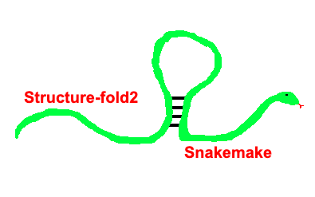
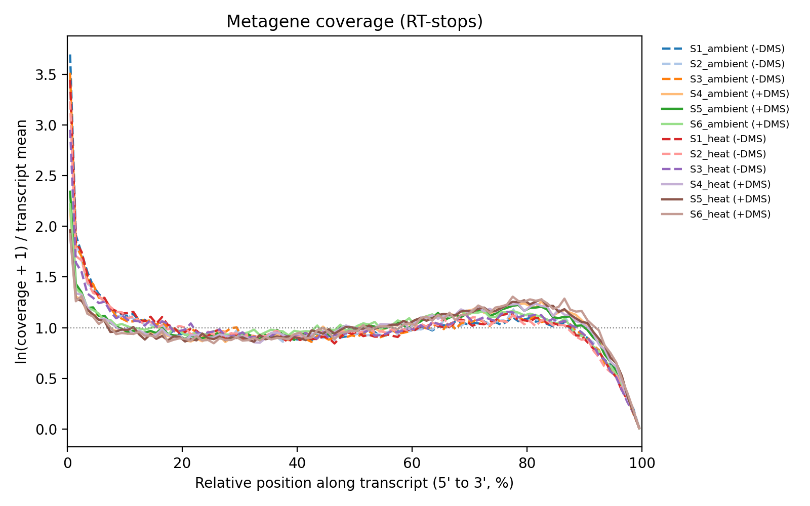

A generalized Snakemake workflow around [StructureFold2](https://github.com/StructureFold2/StructureFold2)
to obtain reactivities from a Structure-seq experiment. Given
raw/trimmed single-end reads and a transcriptome (or a genome + annotation to
build one), it aligns with Bowtie2, counts RT-stops per replicate, and
calculates per-transcript, per-position reactivity. 


# How to run structure-fold2-snakemake
## Setting up the environment

To run this pipeline, you need Snakemake installed. You can create and activate a conda environment 
with containing Snakemake with the following command. 

```
conda env create -f environment.yml
conda activate structure-fold2-snakemake
```
The pipeline itself handles all of the other software dependencies. 


## Quick start

1. Copy `config/config.yaml`, fill in your samplesheet/transcriptome paths
   (every key is documented inline).
2. Build a [samplesheet](docs/samplesheet.md) like `config/samplesheet_example.tsv` (or the
   3-column `config/samplesheet_minimal_example.tsv` if you don't need
   replicate grouping or multi-run concatenation -- see below).
3. `snakemake --sdm conda -j 8 --configfile config/your_config.yaml`


### For more information, check out:
- [3' end bias correction](docs/3_prime_end_bias.md)
- [Depth matching](docs/depth_matching.md)


## Example

`tests/heat_ambient_full/` is a complete, real run you can point to for
what the outputs actually look like: all 12 samples from
`config/samplesheet_rice_heat_ambient.tsv` (3 replicates x plus/minus x
ambient/heat), full FASTQs (no downsampling), cutadapt trimming, and a
`gffread` transcriptome -- run with `tests/heat_ambient_full/run_test.sh`
(or `run_test_cluster.sh` to submit each job to SLURM instead of running
locally).

Alignment stats (`qc/alignment_stats_summary.tsv`):

| sample | total_reads | unique_mapped_pct | multi_mapped_pct | overall_alignment_pct |
|---|---|---|---|---|
| S1_ambient | 57,396,292 | 59.16 | 7.70 | 66.86 |
| S4_ambient | 66,231,085 | 63.09 | 9.16 | 72.24 |
| S1_heat | 48,340,689 | 52.25 | 7.76 | 60.02 |
| S4_heat | 57,980,355 | 59.00 | 9.39 | 68.38 |

`{id}/reactivity.csv`:
```
transcript,position,base,reactivity
Os01t0100100-01,1,G,NA
Os01t0100100-01,2,T,NA
```

The `temperature` column triggers heat correction: 10,201 transcripts
passed the coverage threshold shared by both temperatures
(`qc/heat_correction_shared_transcripts.txt`), and
`qc/heat_correction_scale_factors.log` reports the two correction factors
applied to bring ambient and heat onto a common scale:
```
Higher temp values to be scaled by factor: 0.951013924003
Lower temp values to be scaled by factor: 1.0543066116
```

And the RT-stop metagene plot (`qc/metagene/metagene_rtsc.png`, one line
per sample, dashed = -DMS):



## Testing

`tests/` has a separate, self-contained Snakemake pipeline that downloads a
real (subsampled) public Structure-seq2 dataset and transcriptome, runs
this pipeline against them end-to-end, and sanity-checks the results:

```
snakemake --sdm conda -j 8 -s tests/Snakefile
```

Run from the repo root. See `tests/README.md` for what data it uses, what
"passing" actually checks, and expected runtime/disk usage (it's a real
integration test against ~12 million reads, not a quick unit test).
